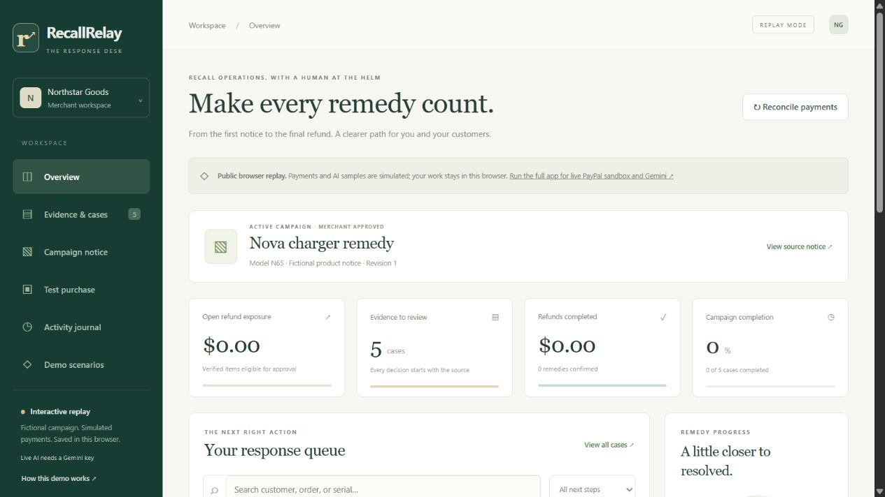

# RecallRelay

**An evidence-led recall response desk: verify the product, approve the remedy, reconcile the PayPal refund.**

Built for the [PayPal AI Hackathon](https://paypalaihackathon.devpost.com/). Original implementation created during the hackathon, October 31, 2026. MIT licensed.

- [Full application: PayPal sandbox + live Gemini](https://recallrelay-sandbox.recallrelay-vmbarathviswam.workers.dev/)
- [Public browser replay: simulated responses](https://vmbarathviswam.github.io/recallrelay/)
- [Public source](https://github.com/vmbarathviswam/recallrelay)
- [Demo script: six scenarios in 2:45](docs/DEMO.md)
- [Verification status and remaining submission work](docs/READINESS.md)
- [Interface design, component research and accessibility](docs/UI-DESIGN.md)



## What it does

A merchant turns a recall notice into a bounded campaign, reviews product-label evidence, links it to a purchase, and approves an exact remedy. The desk shows an AG Grid response queue, a source-evidence drawer, refund exposure by next step, completion tracking, and an exportable activity journal.

**AI interprets evidence; it has no financial tools.** Gemini accepts label images and notice text/images/PDFs, produces structured fields, and quotes the notice. Ordinary code checks model/serial restrictions, purchase identity, currency, payment age, prior refunds, reservations and amounts. A merchant separately verifies evidence, approves the remedy and issues the approved refund.

The fictional Northstar Goods campaign covers the $59 Nova N65 charger in a $77 mixed order. The $18 cable is outside the remedy. Another case has a previous $15 item refund, leaving $44. Ambiguous labels request clarification; a 201-day payment goes to manual handling. Matching nothing never means a product is safe.

## Start locally — no accounts required

Install Node.js **22.18+** (Node 24 recommended), npm and Git. The local server uses Node's built-in SQLite module.

```sh
git clone https://github.com/vmbarathviswam/recallrelay.git
cd recallrelay
npm ci
npm run build
npm start
```

Open **http://127.0.0.1:4173**. With no `.env`, the application starts in **replay mode**. Each browser receives an isolated workspace in `data/recallrelay.sqlite`. Replay responses, illustrative labels and simulated checkout are labelled throughout the UI. This mode does not call PayPal or pretend to run an AI model.

Optional: copy `.env.example` to `.env` (`Copy-Item .env.example .env` in PowerShell, or `cp .env.example .env` on macOS/Linux). Restart after changing environment variables. Reset your replay from **Demo scenarios → Reset my replay**. Nothing under `sources/` is part of the application or edited by its scripts.

## Enable real multimodal AI

Set `GEMINI_API_KEY` in untracked `.env`. The default model is `gemini-3.5-flash-lite`; override `GEMINI_MODEL` with a compatible structured-output model if needed. Keep the key on the server.

This default was verified against the real API on October 31. The higher-capacity model returned temporary service errors during testing; the model change is explicit rather than a silent substitution of sample results. [Live evaluation results](docs/evidence/live-ai-evaluation.json) distinguish actual extraction from deterministic matching checks.

1. Open a case → **Supply or replace evidence**.
2. Upload a PNG, JPEG, WebP or PDF; optional text must transcribe the source.
3. Choose **Extract with live AI**. The UI identifies the live model separately from samples.
4. Inspect the original source and extracted fields. Check the confirmation and choose **Confirm evidence**.

The browser downsamples images for storage. Original uploads are limited to 2 MB; label images submitted directly to the API must be under 180 KB. PDFs can be interpreted but are not retained: keep the source open for merchant review. Do not upload personal information; evidence is sent to Google. Confidence is the model's self-assessment, not a calibrated probability. Missing fields, explicit uncertainty or confidence below 0.85 abstain.

For notices: save the source text first, then **Extract with live AI** (optionally attaching a notice image/PDF). Every returned quotation must exist verbatim in the text. The result is an extraction proposal, not campaign approval. Changing the notice invalidates campaign approval. The prototype's campaign editor deliberately supports model N65 and a constrained serial-prefix format rather than arbitrary unreviewed regexes.

## Enable real PayPal sandbox payments

Use a PayPal developer sandbox **business** account and a separate sandbox **personal buyer** account. Create a sandbox REST app and configure:

For the supplied USD demo, the verified run used a US Personal sandbox buyer. Account country and receiving-currency settings affect sandbox checkout too. If both accounts are India-based, use an appropriate international sandbox buyer for this test; do not change your real account's country. Test credentials work only on `sandbox.paypal.com`.

```dotenv
PAYPAL_MODE=sandbox
PAYPAL_CLIENT_ID=<sandbox app client ID>
PAYPAL_CLIENT_SECRET=<sandbox app secret>
PAYPAL_WEBHOOK_ID=<webhook ID for this same app>
ADMIN_TOKEN=<random secret of at least 32 characters>
APP_ORIGIN=http://127.0.0.1:4173
GEMINI_API_KEY=<server-only Gemini key>
```

Generate `ADMIN_TOKEN` with a password manager or `node -e "console.log(require('node:crypto').randomBytes(32).toString('hex'))"`. Never put secrets in a repository, URL, screenshot or video.

1. Restart and unlock the sandbox workspace with the merchant admin token. The token stays only in page memory, so re-enter it after a reload. The sandbox workspace starts **empty**; replay purchases never reach PayPal.
2. **Test purchase → Create PayPal sandbox purchase** creates an itemized order with server-set prices. Open **Approve on PayPal**, sign in as the sandbox buyer, approve, and return.
3. Choose **Capture approved purchase**. The server checks order identity, `custom_id`, completed capture, currency and exact amount. Capture retries reuse their original request ID.
4. Choose **Open remedy case**. The purchase record shows its assigned synthetic serial (first purchase: `N65-2408-8000`). Upload the matching sample label, run live AI extraction, and verify it as merchant.
5. Record an approval reason, check the merchant confirmation, then **Approve $59 refund**. No refund occurs yet.
6. Choose **Issue approved refund**. PayPal refunds $59 against the original $77 capture. The cable's $18 remains paid. Reconcile and inspect the refund ID and activity journal.

For scripted evidence capture:

```sh
npm run verify:sandbox
# Approve the printed PayPal sandbox URL in a browser, then:
npm run verify:sandbox -- capture <purchase-id>
# Finish human verification, approval, and execution in the UI, then:
npm run verify:sandbox -- evidence <claim-id>
```

Evidence files go to ignored `outputs/sandbox-evidence/`. They contain provider identifiers and outcomes, not tokens. Inspect before publishing. This verifier refuses replay mode and reads provider status again before recording refund proof. Buyer-approved sandbox captures and merchant-approved partial refunds were completed on October 31, 2026, including an end-to-end purchase on the deployed Worker/D1 application. See [local verification](docs/evidence/live-verification.json) and [hosted verification](docs/evidence/hosted-verification.json). The hosted server also performed live Gemini label/notice extraction and processed genuine, signature-verified capture and refund webhooks. The public Pages build remains a separate replay.

If the purchase serial differs from the first sample, Windows users can generate a matching, explicitly synthetic test label with `./scripts/create-samples.ps1 -Serial N65-2408-8001 -OutputDirectory outputs/sandbox-evidence`. Use the serial actually registered to that purchase. This creates a demo fixture, not evidence about a real physical product.

## Webhooks and reconciliation

On a publicly reachable HTTPS deployment, register `/api/webhooks/paypal` on the same sandbox REST app. Subscribe to `PAYMENT.CAPTURE.COMPLETED`, `PAYMENT.CAPTURE.REFUNDED`, `PAYMENT.REFUND.PENDING`, `PAYMENT.REFUND.FAILED`, and relevant dispute events. Use PayPal's current event catalog to confirm availability. Store the returned listener ID as `PAYPAL_WEBHOOK_ID`.

The listener requires PayPal signature headers and verifies them through PayPal's verification API. It accepts only expected PayPal certificate hosts, durably inserts verified event IDs in a deduplicating inbox, and reconciles associated payments from PayPal's API rather than trusting event amounts. Verified dispute notifications hold the linked capture and invalidate approvals; even a later resolution needs manual handling. This is not a complete dispute-management system. A failed background reconciliation remains in the inbox. **Reconcile payments** drains pending events and re-reads cases. PayPal retries deliveries that fail before durable acceptance.

Do not use PayPal's mock webhook simulator to claim a real payment. Mock events do not support the same postback verification path. Unsigned events return 403 without changing payment records.

## Financial safeguards

- USD integer cents; exact item allocations. Prices, totals, capture IDs and refund amounts cannot be supplied by the model or browser.
- Merchant approval is single-use, expires after ten minutes, and is bound to the evidence revision, campaign revision, capture and calculated amount.
- At or beyond 180 elapsed days, unknown dates, unsupported currencies, noncompleted captures, mismatches, known disputes and unattributed external refunds require manual handling.
- Previous attributed item refunds reduce the remedy; unknown external refunds block rather than being guessed onto an item.
- A durable compare-and-swap reservation precedes every refund POST. Concurrent execution cannot send a second refund.
- A timeout or uncertain provider result stays `UNKNOWN`. Recovery reads the original order and refund details, matching the operation's `custom_id`; it never matches by amount alone or blindly creates another refund.
- Pending refunds reserve funds and do not count as completed. A completed refund cannot regress to pending.
- Only the hard-coded PayPal sandbox host is used. There is no production mode or live payment endpoint.

See [architecture and state machines](docs/ARCHITECTURE.md), [security and limits](docs/SECURITY.md), and [API reference](docs/API.md).

## Test and evaluate

```sh
npm test
npm run build
npm run validate
npm run eval
npm run eval -- --live  # requires GEMINI_API_KEY; calls the real model on synthetic images
```

Tests cover domain boundaries, human approval, stale revisions, concurrent calls, persistence, provider refusals, OAuth renewal, HTTP authentication, origin checks, upload validation, AI schema/grounding failures and forged webhooks. Unit/integration provider transports are controlled test doubles; passing them is not a live PayPal certification.

`npm run eval` reports deterministic matching results separately from AI results. It never labels fixture matching as model accuracy. `--live` uses the three synthetic PNG labels under `samples/` and records observed extraction/abstention behavior. These are a small regression set, not a general benchmark. Reports go to ignored `outputs/`.

Import [the Postman collection](api/RecallRelay.postman_collection.json). Set `base_url`; keep `admin_token` in your local environment only. Use Postman's cookie jar for replay. Human confirmations in the collection are deliberate actions, not unattended automation. For new evidence use the returned current revision rather than the sample revision.

## Deployment and judging availability

The full handler runs on Node/SQLite locally and on the deployed Cloudflare Worker/D1 server. Browser assets are bundled into the Worker, with no CDN dependency or commercial grid trial. `drizzle/` contains the generated schema migration. Sites internet publishing is disabled for this workspace, so the full server was deployed directly using Cloudflare's official Wrangler CLI. `.openai/hosting.json` remains the prepared Sites adapter's identity; the direct deployment uses an ignored `wrangler.local.jsonc`. Hosted credentials are Cloudflare runtime secrets; `.env` is local only. See [full-server deployment instructions](docs/CLOUDFLARE.md).

The full application asks for the merchant admin token. The owner can obtain it from their private local `.env`; it stays in page memory and is cleared on reload. Provide judge access through the hackathon's private access-instructions field, never by committing that token or adding it to a public URL. The credential-free Pages replay remains available for immediate exploration.

The public GitHub Pages demo runs the same handler and domain rules entirely in the browser, with an IndexedDB repository. It has no backend, no provider keys and no live financial API calls. Synthetic state persists in that browser; clearing site storage removes it. Its approval and audit controls demonstrate behavior, not an authority boundary against a person editing their own browser. Keep real sandbox merchant data on the full Node app or a separately configured server deployment, protected by the admin token or exact Sites `MERCHANT_USER_ID`. Platform identity headers are trusted only on Sites; the local server strips incoming `oai-*` headers. Never add provider secrets to a Pages build.

Build or preview the public replay separately:

```sh
npm run build:demo
npm run preview:demo
# http://127.0.0.1:4180/recallrelay/
```

The `Publish public replay` workflow tests and deploys Pages on pushes to `main`. A fork owner must enable GitHub Pages with GitHub Actions as the publishing source.

Docker alternative:

```sh
docker build -t recallrelay .
docker run --rm -p 4173:4173 -v recallrelay-data:/app/data recallrelay
```

For a generic Node host, set `HOST=0.0.0.0`, `PORT`, `APP_ORIGIN` and a durable `DATABASE_PATH`. Do not use ephemeral filesystem storage for financial records. Maintain the URL and database through **December 15, 2026, 9:30 p.m. IST**. [Operations and submission calendar](docs/OPERATIONS.md) reserves early review and fix time. Future uptime still requires the hosting account to remain active; local setup remains an independent runnable submission path.

## Tools and licenses

- PayPal Orders v2, Payments v2, OAuth2 and verified Webhooks: actual purchase, partial-refund and reconciliation adapters.
- Google Gemini: multimodal structured label extraction and source-grounded notice extraction. Optional in replay; required for live AI proof.
- AG Grid Community: custom case/status renderers, sortable/filterable work queue, keyboard review, and audit exploration, integrated with custom exposure/completion widgets.
- Node, SQLite, Cloudflare Worker/D1, esbuild and Drizzle Kit: runtime, persistence, bundling and schema migrations.
- Postman: documented integration and negative-path collection.

No AG Grid Enterprise or AG Studio license is required. Do not claim AG Studio, Elastic, APIMatic, Render or other sponsor usage that is not implemented. See [third-party notices](THIRD_PARTY_NOTICES.md) and [research sources](docs/SOURCES.md). AI coding assistance was used to implement and test the project; the product's AI is the explicit Gemini integration.

## Prototype boundaries

One merchant, USD, one constrained fictional campaign, synthetic catalog products and a maximum of 20 demonstration purchases per workspace. No automatic legal eligibility, safety certification, manufacturer authorization, fraud guarantee, or real-money deployment. No customer email delivery, carrier returns integration, background recall-feed polling, arbitrary marketplace onboarding, or complete production dispute ingestion is claimed. See the documented remaining work before submission.
