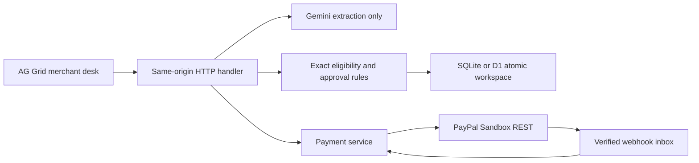
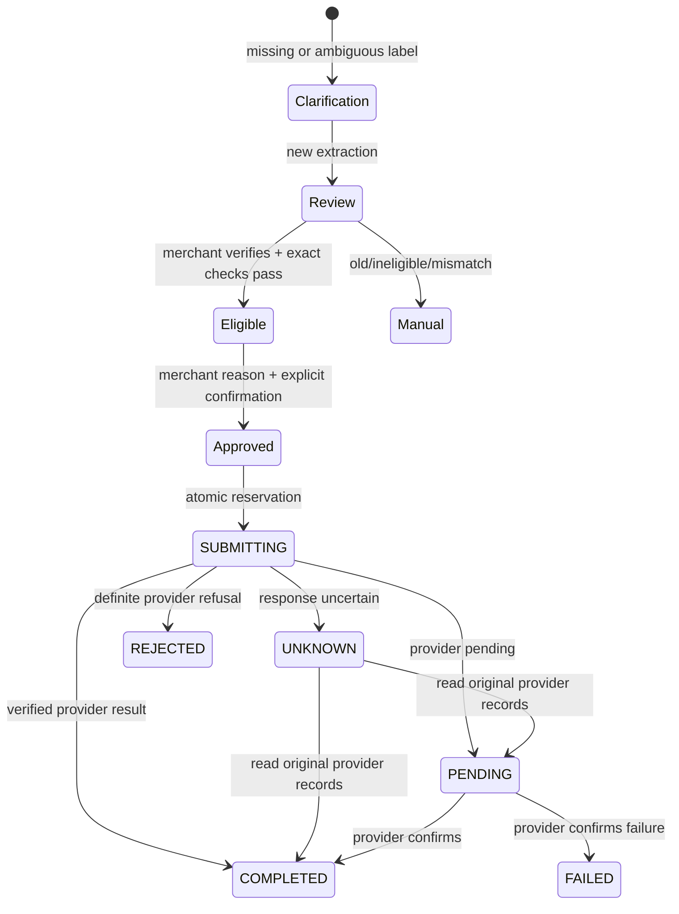

# Architecture and invariants

## Shape

`src/domain.mjs` owns exact money parsing, matching, eligibility, approvals and state transitions. It has no network calls. `src/service.mjs` orchestrates the domain and payment adapter. `src/paypal.mjs` has a hard-coded sandbox origin, short timeouts, server-side token caching and a single 401 renewal retry. A refund write is never automatically retried after an uncertain failure.

`src/ai.mjs` calls Gemini's structured-output API with inline media. The AI has no tools, purchase identifiers, credentials, approval function or refund endpoint. Its output is reduced to permitted extraction fields. A low-confidence result requests clarification. Notice quotations must match the supplied source exactly. A model can still misread text or invent a plausible transcription; source comparison by the merchant remains mandatory.

`web/app.mjs` builds the desk with AG Grid Community and custom widgets. `scripts/build.mjs` bundles the UI and embeds assets in a Worker module. `scripts/server.mjs` adapts Node HTTP and SQLite to the same Request/Response handler used by `worker/index.mjs`.

## Database design

| Table | Purpose |
|---|---|
| `workspaces(id, revision, snapshot, updated_at)` | Atomic aggregate: campaign, immutable purchase allocations, evidence, approvals, operations and bounded journal. |
| `webhook_inbox(id, payload, status, received_at)` | Verified, deduplicated provider event inbox. Processing failures remain pending. |
| `local_migrations(name)` | Node-only applied migration ledger. Hosted D1 uses the platform migration lifecycle. |

The aggregate design is intentional for this small prototype: every mutation reads a revision and commits using `UPDATE ... WHERE revision = ?`. Zero updated rows means contention; the side-effect-free transformation retries against the new snapshot. Domain approvals, reservations and audit entries therefore commit together. A refund POST occurs only after a successful persisted reservation. Never perform an external call inside a CAS callback.

Replay workspace identifiers are random, HttpOnly, SameSite=Strict cookies. They are bearer capabilities for isolated synthetic data, not production user identities. Sandbox uses one protected `merchant-sandbox` aggregate. Snapshot size is bounded below 900 KB; the operational journal retains 500 events. Financial operation records are retained independently of journal truncation. This is a prototype scalability boundary, not an enterprise ledger claim.

## Approval and refund states

An approval hashes the current plan: capture, item, amount, evidence and campaign revisions, total and previous attributed refund. It expires after ten minutes and is consumed when the operation is reserved. Evidence or campaign changes clear approvals. A changed provider state is re-read before approval and execution. Completed, pending and unresolved reservations prevent over-refunds within the application's authority.

There is an unavoidable interval between reading PayPal and writing PayPal. A separate external actor can act during it. PayPal's own refund constraints remain the final boundary. External refunds that cannot be attributed to an item route manually; the app does not guess which item remains refundable.

## Lost-response recovery

Every operation persists a stable request ID and unique `custom_id` before sending. An uncertain response becomes `UNKNOWN`; a process crash can leave `SUBMITTING`. Both lock that capture. Reconciliation reads the original order, hydrates refund details by ID and matches `custom_id` (or an already-recorded refund ID), then validates amount, currency and status. No match means the state stays unresolved. It does not create another refund or assume absence means failure. Resolve an uncorrelatable provider record manually.

The replay's lost-response button stores a simulated provider refund before discarding its response. Reconciliation finds that same record. Tests assert one operation, one provider refund and no second submission. This validates orchestration, not PayPal availability.

## Purchase binding and money

The catalog fixes USD item gross allocations. The mixed order is $59 + $18 = $77, with no separate shipping/tax. The refund is at most affected-item gross minus previous attributed item refunds, capped by remaining capture gross. Future shipping/tax support must allocate those amounts at checkout, preserve rounding invariants, and state the merchant remedy explicitly.

Capture confirmation checks the PayPal order ID, `custom_id`, completed capture, currency and exact total. Capture calls reuse a stable request ID. A completed purchase can be read repeatedly without adding another application purchase. A refunded capture is not evidence that an unrelated item is entitled to a remedy.
